# Clima-App: Explicación Sencilla Paso por Paso del Proyecto

> **Proyecto de Métodos Numéricos — Universidad de los Llanos**  
> **Autores:** Julian Esteban Romero Guzmán · Eduar Alexis Murcia Rodríguez  
> **Tema:** Pronóstico meteorológico mediante mallas espaciales y diferencias finitas

---

## 🎯 1. ¿De dónde nació este proyecto y qué queríamos lograr?

En la propuesta inicial del curso de Métodos Numéricos se planteó una idea fascinante: **¿cómo hacen los meteorólogos para predecir el clima de mañana usando solo matemáticas y computadores?**

El documento de partida proponía dividir un mapa en una cuadrícula (malla) y estimar la temperatura futura con una intuición básica:
$$\text{"Temperatura futura} \approx \text{Promedio de los vecinos} + \text{Efecto del viento"}$$

Sin embargo, esa idea inicial tenía varias preguntas abiertas:
1. ¿Cuál es la fórmula matemática exacta que rige ese comportamiento?
2. ¿Por qué si saltamos de hora en hora la computadora se "vuelve loca" y da temperaturas de millones de grados?
3. ¿Cómo pasar de una matriz de números abstractos a algo que **cualquier persona común entienda a simple vista** (si lloverá, si hará sol, cómo se mueve el viento)?
4. ¿Se puede usar con el clima real de hoy en vez de solo datos inventados?

A continuación te explicamos paso a paso cómo resolvimos cada uno de estos desafíos hasta convertirlo en una aplicación web interactiva en 3D con pronósticos en vivo.

---

## 🧭 2. El Paso a Paso del Desarrollo

```mermaid
flowchart LR
    F1["1. Física Real<br/>(Advección-Difusión)"] --> F2["2. La Malla<br/>(Grid 2D)"]
    F2 --> F3["3. Algoritmo<br/>(FTCS + Upwind)"]
    F3 --> F4["4. Estabilidad<br/>(Control CFL)"]
    F4 --> F5["5. Simulador<br/>(24h / 144 pasos)"]
    F5 --> F6["6. Validación<br/>(Error L2 cuadrático)"]
    F6 --> F7["7. Backend API<br/>(FastAPI)"]
    F7 --> F8["8. Visor 3D<br/>(Relieve + Lluvia)"]
    F8 --> F9["9. App Móvil<br/>(PWA)"]
    F9 --> F10["10. Clima Real<br/>(Open-Meteo en vivo)"]
```

---

### Paso 1: La Fórmula Matemática Oculta
*Resolviendo la ambigüedad del documento.*

En la naturaleza, la temperatura en el aire cambia por dos razones:
1. **Difusión ($\alpha$):** El calor fluye espontáneamente de las zonas calientes a las zonas frías (como cuando dejas una taza de café caliente en una mesa).
2. **Advección ($u, v$):** El viento empuja la masa de aire de un lugar a otro.

La ecuación física exacta que describe esto es la **Ecuación de Advección-Difusión en 2D**:
$$
\frac{\partial T}{\partial t} = \alpha \left(\frac{\partial^2 T}{\partial x^2} + \frac{\partial^2 T}{\partial y^2}\right) - u\frac{\partial T}{\partial x} - v\frac{\partial T}{\partial y}
$$

**El gran descubrimiento del proyecto:**  
Cuando discretizamos la difusión en diferencias finitas y fijamos el parámetro adimensional de difusión en $r = 1/4$ sin viento, la fórmula se simplifica matemáticamente a:
$$
T^{\text{nuevo}}_{i,j} = \frac{T_{\text{Norte}} + T_{\text{Sur}} + T_{\text{Este}} + T_{\text{Oeste}}}{4}
$$
¡Es exactamente el **promedio de los 4 vecinos** mencionado en el documento de propuesta! Demostramos que la intuición inicial era en realidad un caso particular de la ley fundamental de difusión del calor.

---

### Paso 2: Dividir el Mapa en una Cuadrícula (`grid.py`)
No podemos calcular la temperatura en infinitos puntos del cielo. Por eso, dividimos una región geográfica (por ejemplo, los Llanos Orientales o un área de $500 \times 500\text{ km}$) en una **malla de $50 \times 50$ celdas**, separadas cada $10\text{ km}$ ($\Delta x = \Delta y = 10\,000\text{ m}$).

Cada celda de la matriz guarda la temperatura en ese punto exacto. Además, definimos qué pasa en los bordes del mapa:
- **Frontera fija (Dirichlet):** El borde exterior mantiene una temperatura constante.
- **Frontera periódica:** El aire que sale por el Este vuelve a entrar por el Oeste.

---

### Paso 3: El Algoritmo Numérico sin Bucles Lentos (`schemes.py`)
Si usáramos bucles `for` celda por celda en Python, calcular 144 pasos de tiempo tardaría varios minutos.

Para hacerlo instantáneo, aplicamos **vectorización con NumPy**:
- **Para la difusión:** Usamos **FTCS** (*Forward Time, Centered Space*), calculando las diferencias con los vecinos simultáneamente en memoria.
- **Para el viento:** Usamos el esquema **Upwind** (*a favor del viento*). Si el viento sopla hacia el Este ($u > 0$), la celda toma la temperatura del Oeste (de donde viene el aire). Si sopla hacia el Oeste ($u < 0$), mira hacia el Este.

El algoritmo calcula toda la malla de $50 \times 50$ en menos de **0.5 milisegundos por paso**.

---

### Paso 4: La Estabilidad y el Peligro de "Saltar Horas" (`stability.py`)
En el PDF original se advertía: *"Si el paso de tiempo es muy grande, el pronóstico se daña"*.

Esto se debe a la **Condición de Estabilidad CFL (Courant-Friedrichs-Lewy)**. En métodos explícitos, la información física no puede viajar más rápido que la información de la malla numérica:
$$
4r + |c_x| + |c_y| \le 1
$$

- **Paso seguro ($\Delta t = 600\text{ s} = 10\text{ min}$):** El valor combinado da $0.42 \le 1.0$. La simulación es suave y realista.
- **Paso peligroso ($\Delta t = 3600\text{ s} = 1\text{ hora}$):** El valor salta a $2.52 > 1.0$. Los números explotan a trillones de grados y terminan en `NaN` (error numérico).

Creamos un guardián matemático (`stability.py`) que calcula el $\Delta t$ máximo permitido antes de cada cálculo y alerta al usuario.

---

### Paso 5: La Máquina del Tiempo de 24 Horas (`simulator.py`)
Un pronóstico de 24 horas consiste en avanzar 144 veces en el tiempo ($\Delta t = 10\text{ min}$):
$$144 \text{ pasos} \times 10\text{ min} = 1440\text{ min} = 24\text{ horas}$$

El simulador guarda una "fotografía" térmica en cada paso, asegurándose de que:
- Ninguna celda contenga valores nulos (`NaN` o `Inf`).
- La energía térmica total se conserve de acuerdo con la física.
- El cálculo total de las 24 horas demore **menos de 0.2 segundos**.

---

### Paso 6: Demostración de Rigor Científico (Convergencia $L_2$)
¿Cómo sabemos que la computadora no está inventando resultados bonitos pero incorrectos?

Existe una solución analítica exacta de la física teórica: la **difusión de una campana de Gauss en 2D**:
$$
T_{\text{exacta}}(x, y, t) = \frac{Q}{4\pi\alpha (t + t_0)} \exp\left(-\frac{x^2 + y^2}{4\alpha(t + t_0)}\right)
$$

Pusimos a competir nuestro algoritmo numérico contra la solución exacta reduciendo el tamaño de celda a la mitad ($40\text{ km} \to 20\text{ km} \to 10\text{ km} \to 5\text{ km}$).  
El resultado confirmó un **orden de convergencia cuadrático ($p \approx 2.01$)**: si la cuadrícula es el doble de fina, **el error se reduce a la cuarta parte ($2^2 = 4$)**.

---

### Paso 7: El Cerebro del Servidor (`FastAPI`)
Construimos un servidor web robusto en Python:
- **`GET /stability`**: Le preguntas si unos parámetros son seguros y te dice el $\Delta t$ máximo.
- **`POST /simulate`**: Recibe parámetros o matrices de datos y devuelve todas las fotos térmicas de las 24 horas.
- Si alguien intenta meter un $\Delta t$ inestable, el servidor rechaza la petición con una explicación clara para evitar cálculos inútiles.

---

### Paso 8: El Salto Visual: "Hacerlo Fácil para Cualquier Persona"
Una matriz de números o un mapa 2D plano no le dice mucho a una persona común. Para solucionarlo, construimos:

1. **Visor 3D Interactivo (Three.js):**
   - La temperatura se convierte en una **montaña de relieve**: las zonas calientes se elevan hacia arriba y se tiñen de rojo/amarillo; las zonas frescas son valles azules.
   - Puedes rotar el mapa con el dedo o el ratón como si fuera una maqueta física.
   - **Flechas 3D de viento:** Flotan sobre el terreno mostrando hacia dónde sopla el aire.
   - **Gotas de lluvia cayendo:** Si se detectan condiciones lluviosas, un sistema de partículas simula lluvia realista cayendo sobre el terreno.

2. **Tarjeta de Clima Cotidiano:**
   - En lugar de decir *"Humedad = 84%, $\nabla P = -3.2\text{ hPa}$"*, muestra:
     - 🌧️ *«Lluvia Ligera con viento del Este»*
     - *«Probabilidad de lluvia: 78% | Sensación Térmica: 29°C»*
   - Botones rápidos: `[Ahora]`, `[+3h]`, `[+6h]`, `[+12h]`, `[+24h]` para viajar en el tiempo con un solo toque.

---

### Paso 9: Aplicación Móvil (PWA)
Usando Vite PWA y Service Workers:
- La aplicación se puede **instalar en la pantalla de inicio del celular** como si fuera una app nativa de Android o iOS.
- Incluye un motor numérico local en JavaScript que calcula los 144 pasos directamente en el procesador del teléfono, funcionando incluso **sin conexión a internet**.

---

### Paso 10: Clima Real en Vivo (Open-Meteo)
En lugar de depender únicamente de círculos calientes sintéticos:
1. La aplicación se conecta con la API global gratuita **Open-Meteo**.
2. Descarga la temperatura, viento, humedad y presión real del día de hoy en estaciones colombianas (ej. **Villavicencio / Llanos Orientales**, **Barranquilla / Caribe**, **Medellín / Andina**).
3. Mediante el algoritmo de **Interpolación por Distancia Inversa (IDW)**, siembra la cuadrícula 2D con el clima del momento.
4. El motor numérico hace evolucionar el clima real hacia las siguientes 24 horas.

---

## 💡 En Resumen

| ¿Qué teníamos al inicio? | ¿Qué logramos al final? |
|---|---|
| Una fórmula vaga de *"promedio + viento"* | Demostración matemática formal de la ecuación de calor y advección |
| Matrices abstractas difíciles de entender | Maqueta 3D interactiva con lluvia, viento y pronóstico cotidiano |
| Cálculos lentos con bucles `for` | Simulación vectorial ultrarrápida ($<0.2\text{ s}$ en 24 h) |
| Riesgo de explosión numérica | Validador CFL estricto que garantiza estabilidad |
| Solo datos simulados e inventados | Conexión en vivo con satélites y estaciones de Open-Meteo |
| Proyecto solo de consola | PWA instalable en celular + API REST en FastAPI |
