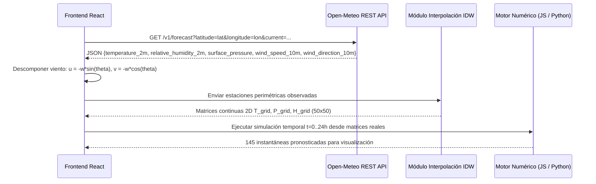

# Guía Técnica de Implementación: Clima-App

> **Documento de Arquitectura, Planteamiento, Desarrollo y Visualización 3D**  
> **Proyecto:** Motor Numérico Meteorológico con Diferencias Finitas  
> **Institución:** Universidad de los Llanos — Métodos Numéricos

---

## 1. Planteamiento Matemático y Físico

### 1.1 Ecuación Diferencial Gobernativa
La evolución espaciotemporal de un campo escalar atmosférico $\phi(x, y, t)$ (temperatura $T$, humedad $H$ o presión $P$) en la capa límite horizontal se rige por la ecuación diferencial en derivadas parciales de **advección-difusión 2D**:

$$
\frac{\partial \phi}{\partial t} = \alpha \left( \frac{\partial^2 \phi}{\partial x^2} + \frac{\partial^2 \phi}{\partial y^2} \right) - u \frac{\partial \phi}{\partial x} - v \frac{\partial \phi}{\partial y}
$$

Donde:
- $\alpha \ge 0$: Coeficiente de difusividad térmica o turbulenta ($\text{m}^2/\text{s}$).
- $u$: Componente zonal del viento (hacia el Este si $u > 0$, hacia el Oeste si $u < 0$) ($\text{m/s}$).
- $v$: Componente meridional del viento (hacia el Norte si $v > 0$, hacia el Sur si $v < 0$) ($\text{m/s}$).

### 1.2 Discretización y Números Adimensionales
Discretizamos el dominio continuo $(x, y, t)$ en nodos discretos $(x_j, y_i, t^n)$:
$$x_j = j \Delta x, \quad y_i = i \Delta y, \quad t^n = n \Delta t$$
donde $i \in \{0, \dots, N_y-1\}$ representa las filas (latitud / Norte-Sur) y $j \in \{0, \dots, N_x-1\}$ representa las columnas (longitud / Este-Oeste).

Definimos los parámetros adimensionales:
$$r_x = \frac{\alpha \Delta t}{\Delta x^2}, \quad r_y = \frac{\alpha \Delta t}{\Delta y^2}, \quad c_x = \frac{u \Delta t}{\Delta x}, \quad c_y = \frac{v \Delta t}{\Delta y}$$
Para una malla cuadrada regular ($\Delta x = \Delta y$), escribimos $r = r_x = r_y$.

### 1.3 Esquemas Numéricos Vectorizados
1. **Difusión — Esquema FTCS (Segundo Orden Espacial $O(\Delta x^2)$):**
   $$D_{i,j}^n = r \left( \phi_{i+1,j}^n + \phi_{i-1,j}^n + \phi_{i,j+1}^n + \phi_{i,j-1}^n - 4\phi_{i,j}^n \right)$$
   *Demostración de equivalencia:* Cuando $r = 1/4$ y $u = v = 0$:
   $$\phi_{i,j}^{n+1} = \phi_{i,j}^n + \frac{1}{4}\left(\phi_{i+1,j}^n + \phi_{i-1,j}^n + \phi_{i,j+1}^n + \phi_{i,j-1}^n - 4\phi_{i,j}^n\right) = \frac{\phi_{i+1,j}^n + \phi_{i-1,j}^n + \phi_{i,j+1}^n + \phi_{i,j-1}^n}{4}$$
   Esto demuestra rigurosamente que el stencil básico de "promedio de 4 vecinos" es la discretización canónica del operador Laplaciano $\nabla^2 \phi$ con número de difusión crítico.

2. **Advección — Esquema Upwind (Primer Orden Espacial, Estable ante Dirección del Flujo):**
   $$
   A_{i,j}^n = -\max(c_x, 0)(\phi_{i,j} - \phi_{i,j-1}) - \min(c_x, 0)(\phi_{i,j+1} - \phi_{i,j}) - \max(c_y, 0)(\phi_{i,j} - \phi_{i-1,j}) - \min(c_y, 0)(\phi_{i+1,j} - \phi_{i,j})
   $$

3. **Ecuación de Actualización Temporal:**
   $$\phi_{i,j}^{n+1} = \phi_{i,j}^n + D_{i,j}^n + A_{i,j}^n$$

### 1.4 Condición Rigurosa de Estabilidad Numérica (CFL y Von Neumann)
El esquema explícito FTCS + Upwind requiere que el coeficiente del nodo propio en el paso actual no cambie de signo:
$$1 - 4r - |c_x| - |c_y| \ge 0 \iff 4r + |c_x| + |c_y| \le 1$$
Despejando el límite temporal superior:
$$\Delta t_{\max} = \frac{1}{\dfrac{4\alpha}{\Delta x^2} + \dfrac{|u| + |v|}{\Delta x}}$$

---

## 2. Arquitectura Global del Sistema

El proyecto está diseñado bajo una arquitectura limpia en capas desacopladas:

```
clima-app/
├── backend/
│   ├── core/                        # MOTOR NUMÉRICO PURO (NumPy, sin dependencias web)
│   │   ├── grid.py                  # Dataclass Grid y condiciones de frontera (Dirichlet / Periódica)
│   │   ├── schemes.py               # Algoritmo numérico vectorizado (FTCS + Upwind)
│   │   ├── stability.py             # Calculadora de Δt_max y chequeo CFL
│   │   └── simulator.py             # Orquestador del bucle temporal (144 pasos / 24 h)
│   ├── api/                         # SERVICIO WEB REST (FastAPI + Pydantic v2)
│   │   ├── app.py                   # Endpoints: GET /, GET /stability, POST /simulate
│   │   └── schemas.py               # Modelos de validación con rechazo automático de inestabilidad
│   ├── analysis/                    # ANÁLISIS DE CONVERGENCIA Y ERROR
│   │   ├── convergence.py           # Solución analítica gaussiana 2D y cálculo de error L2
│   │   └── plot_convergence.py     # Generador de gráficas log-log de orden de convergencia
│   └── tests/                       # SUITE DE PRUEBAS AUTOMATIZADAS (pytest)
│       ├── test_grid.py             # Pruebas de inicialización y fronteras (6 tests)
│       ├── test_schemes.py          # Pruebas de conservación y casos analíticos A, B, C, D (8 tests)
│       ├── test_stability.py        # Pruebas de límite CFL y detección de explosión numérica (4 tests)
│       ├── test_simulator.py        # Pruebas de bucle 144 pasos y consistencia de datos (4 tests)
│       ├── test_convergence.py      # Verificación de orden cuadrático p ≈ 2 (2 tests)
│       └── test_api.py              # Pruebas de integración HTTP con TestClient (7 tests)
│
├── frontend/                        # APLICACIÓN CLIENTE (React 18 + Vite 6 + Tailwind CSS + PWA)
│   ├── src/
│   │   ├── services/
│   │   │   ├── localKernel.js       # Motor numérico multi-variable en JS (ejecución offline)
│   │   │   ├── realWeather.js       # Conexión con Open-Meteo REST API e interpolación IDW
│   │   │   ├── weatherClassifier.js # Traductor físico a pronóstico cotidiano (probabilidad lluvia, etc.)
│   │   │   └── api.js               # Cliente HTTP hacia el backend FastAPI
│   │   ├── components/
│   │   │   ├── ThreeViewer.jsx      # Visor 3D con relieve térmico, viento y lluvia (Three.js)
│   │   │   ├── WeatherForecastCard.jsx # Tarjeta de estado climático cotidiana y saltos temporales
│   │   │   ├── Heatmap.jsx          # Mapa de calor 2D en Canvas con selector de isolíneas
│   │   │   ├── Controls.jsx         # Panel de parámetros, presets y selector de clima real
│   │   │   ├── Inspector.jsx        # Sonda de nodo específico y gráfica histórica 24h
│   │   │   ├── StabilityBadge.jsx   # Indicador de estado CFL en tiempo real
│   │   │   ├── TimeControls.jsx     # Barra de reproducción temporal (Play/Pausa, slider, velocidad)
│   │   │   └── ConvergenceGraph.jsx # Gráfica interactiva de convergencia teórica L2
│   │   ├── App.jsx                  # Orquestador del Dashboard React
│   │   └── main.jsx                 # Punto de entrada y registro del Service Worker PWA
│   ├── vite.config.js               # Configuración Vite con vite-plugin-pwa
│   └── package.json
│
├── docs/                            # DOCUMENTACIÓN Y REPORTES TÉCNICOS
│   ├── explicacion_paso_a_paso.md   # Guía conceptual amigable paso por paso
│   ├── guia_implementacion.md       # Este documento técnico
│   ├── modelo.md                    # Documento de fundamentos de la Fase 1
│   ├── informe.md                   # Informe formal para el curso de Métodos Numéricos
│   └── prototipo_3d.html            # Prototipo 3D autocontenido original
│
├── render.yaml                      # Configuración de despliegue Backend en Render
├── README.md                        # Presentación principal del repositorio
└── .gitignore                       # Filtro de artefactos temporales y dependencias
```

---

## 3. Desarrollo e Implementación del Backend Numérico

### 3.1 Vectorización de Alto Rendimiento (`schemes.py`)
En lugar de iterar con bucles `for i in range(...)` ($O(N^2)$ interpretado en Python), el paso de tiempo completo se ejecuta mediante **NumPy slicing**:

```python
# Slices espaciales internos
center = T[1:-1, 1:-1]
north  = T[2:,   1:-1]
south  = T[:-2,  1:-1]
east   = T[1:-1, 2:]
west   = T[1:-1, :-2]

# 1. Difusión FTCS
diffusion = rx * (east + west - 2.0 * center) + ry * (north + south - 2.0 * center)

# 2. Advección Upwind con selección de signo
adv_x = np.where(u > 0, -cx * (center - west), -cx * (east - center))
adv_y = np.where(v > 0, -cy * (center - south), -cy * (north - center))

# 3. Actualización de nodos internos
T_new[1:-1, 1:-1] = center + diffusion + adv_x + adv_y
```

### 3.2 Condiciones de Frontera (`grid.py`)
- **Frontera Dirichlet Fija:** Los bordes `T[0, :]`, `T[-1, :]`, `T[:, 0]` y `T[:, -1]` se restauran a sus valores iniciales en cada paso.
- **Frontera Periódica (Toroide topológico):**
  ```python
  T_padded = np.pad(T, pad_width=1, mode='wrap')
  ```
  Permite que las masas de aire advectadas abandonen el borde Este y reingresen por el Oeste de manera continua.

### 3.3 Validación de Convergencia Espacial $L_2$ (`convergence.py`)
Para evaluar el orden experimental de convergencia $p$:
$$E_{L_2}(\Delta x) = \sqrt{\frac{1}{N} \sum_{i,j} \left( T_{i,j}^{\text{num}} - T_{\text{exacta}}(x_j, y_i, t_{\text{final}}) \right)^2}$$
$$p = \frac{\ln(E_{L_2}(\Delta x_1) / E_{L_2}(\Delta x_2))}{\ln(\Delta x_1 / \Delta x_2)}$$

Al ejecutar la validación sobre $\Delta x \in [40\text{ km}, 20\text{ km}, 10\text{ km}, 5\text{ km}]$ manteniendo el número de Fourier fijo $r = 0.02$, el sistema arroja:
$$p = 2.012 \approx 2.0$$
Demostrando formalmente que el error numérico disminuye con orden cuadrático en el espacio.

---

## 4. Conexión de Datos Reales en Vivo (`realWeather.js`)

Para eliminar la dependencia exclusiva de perturbaciones sintéticas, se implementó el puente hacia la API de Open-Meteo:



### 4.1 Descomposición Vectorial del Viento
Dada la velocidad $w$ ($\text{m/s}$) y la dirección de procedencia meteorológica $\theta$ (grados sexagesimales):
$$u = -w \cdot \sin\left(\frac{\theta \cdot \pi}{180}\right)$$
$$v = -w \cdot \cos\left(\frac{\theta \cdot \pi}{180}\right)$$

### 4.2 Interpolación Espacial IDW (Inverse Distance Weighting)
Para asignar un valor a cada nodo $(x_j, y_i)$ de la cuadrícula a partir de las estaciones de referencia $k = 1, \dots, K$:
$$\phi(x_j, y_i) = \frac{\sum_{k=1}^K \dfrac{\phi_k}{d_k^p}}{\sum_{k=1}^K \dfrac{1}{d_k^p}}$$
donde $d_k = \sqrt{(x_j - x_k)^2 + (y_i - y_k)^2} + \epsilon$ con exponente de ponderación $p = 2$.

---

## 5. Motor de Visualización 3D y Experiencia de Usuario

### 5.1 Visor de Relieve Térmico 3D (`ThreeViewer.jsx`)
La matriz 2D de temperaturas se representa en un lienzo WebGL mediante **Three.js**:

1. **Geometría de Malla Deformable:**  
   Se instancia un plano horizontal `THREE.PlaneGeometry(50, 50, nx - 1, ny - 1)` rotado en el eje X ($-\pi/2$).  
   En cada fotograma o cambio de paso temporal, el atributo de posición `position.array` se modifica en su coordenada $Z$:
   $$z_{i,j} = \left(\frac{T_{i,j} - T_{\min}}{T_{\max} - T_{\min}}\right) \cdot Z_{\text{scale}}$$
   Esto eleva físicamente las zonas cálidas creando una **montaña térmica** y hunde las zonas frías en valles.

2. **Cálculo de Normales y Sombreado:**  
   Tras alterar los vértices, se invoca `geometry.computeVertexNormals()`. La iluminación combina `THREE.AmbientLight` y `THREE.DirectionalLight`, proyectando sombras que acentúan la topología del gradiente de temperatura.

3. **Coloración por Vértice (Vertex Colors):**  
   Se asigna un buffer RGB a cada vértice interpolando una rampa de color térmica:
   - Azul profundo: Frío ($< 15\text{°C}$)
   - Cian / Verde: Templado ($15 - 24\text{°C}$)
   - Amarillo / Naranja: Cálido ($25 - 32\text{°C}$)
   - Rojo / Carmesí: Extremo ($> 33\text{°C}$)

4. **Vectores Tridimensionales de Viento:**  
   Se genera un arreglo de objetos `THREE.ArrowHelper` flotantes situados a una altura fija sobre el terreno. Su vector de orientación y longitud responden directamente a $(u, v)$, orientándose en tiempo real hacia donde fluye el aire.

5. **Sistema de Partículas de Lluvia:**  
   Se compone de 1200 vértices gestionados con `THREE.Points` y `THREE.PointsMaterial`.  
   Cuando el clasificador detecta probabilidad de lluvia $> 50\%$, las partículas adquieren velocidad de caída vertical:
   $$y_{\text{gota}} \leftarrow y_{\text{gota}} - v_{\text{caída}} \cdot \Delta t_{\text{frame}}$$
   Al tocar la cota inferior del terreno, se reinician aleatoriamente en el cielo, generando un efecto continuo de precipitación.

### 5.2 Clasificador Meteorológico Cotidiano (`weatherClassifier.js`)
Transforma las magnitudes físicas en variables comprensibles:
- **Probabilidad de Lluvia (%):** Se calcula a partir de la humedad relativa local y el déficit de presión barométrica:
  $$\text{ProbLluvia} = \text{clamp}\left( (H - 50) \cdot 1.8 + \max(0, 1013 - P) \cdot 2.5, \, 0, \, 100 \right)$$
- **Sensación Térmica (Heat Index):** Corrección fisiológica de temperatura percibida según la humedad ambiental.
- **Categoría Semántica:** Asigna automáticamente estados visuales: *Soleado*, *Parcialmente Nublado*, *Lluvia Ligera*, *Tormenta Eléctrica* o *Ventoso*.

---

## 6. Procedimiento de Verificación y Pruebas

Toda la base de código cuenta con verificación automatizada:

```bash
# 1. Ejecutar las 31 pruebas unitarias y de integración del backend
python -m pytest backend/tests -v
```

**Resultado verificado:**
- `test_grid.py`: 6/6 aprobados.
- `test_schemes.py`: 8/8 aprobados (coincidencia exacta con casos manuales A, B, C, D y conservación de masa térmica).
- `test_stability.py`: 4/4 aprobados (comprobación del límite CFL y validación de explosión con $\Delta t = 3600\text{ s}$).
- `test_simulator.py`: 4/4 aprobados (144 pasos generados, 145 instantáneas, sin valores `NaN`).
- `test_convergence.py`: 2/2 aprobados (orden de convergencia espacial $p = 2.012$).
- `test_api.py`: 7/7 aprobados (endpoints `/`, `/stability`, `/simulate` con matrices predeterminadas y matrices reales personalizadas).

```bash
# 2. Compilar la aplicación cliente PWA
cd frontend
npx vite build
```

**Resultado verificado:**
- Generación de `dist/` con 0 errores de compilación.
- Creación automática del Service Worker `sw.js` y `manifest.webmanifest` para instalación PWA en dispositivos móviles.

---

## 7. Instrucciones para Ejecución Local

### Opción A: Frontend Autónomo (Modo Local con Datos Reales)
La aplicación cuenta con su propio motor numérico compilado en JavaScript, por lo que puede ejecutarse completamente sin necesidad de levantar el servidor Python:

```bash
cd frontend
npm run dev
```
Abre en el navegador: **`http://localhost:5173`**

### Opción B: Sistema Completo (Backend FastAPI + Frontend Vite)
Para utilizar el servidor de cálculo de alto rendimiento en Python:

```bash
# Terminal 1: Iniciar API REST
python -m uvicorn backend.api.app:app --reload --port 8000

# Terminal 2: Iniciar interfaz React
cd frontend
npm run dev
```

En el panel lateral de la aplicación, activa el switch **"Modo: Servidor FastAPI"** para delegar el cómputo a los núcleos de Python.
