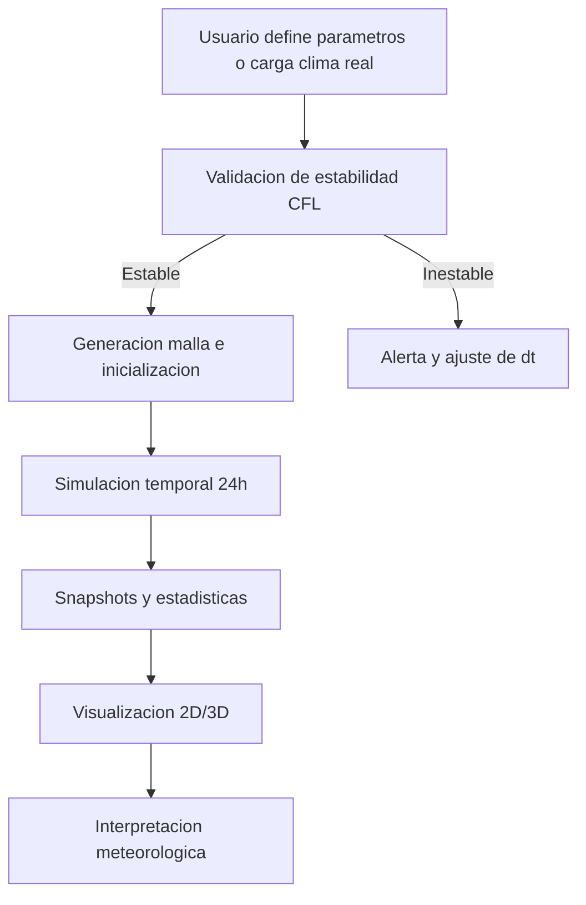

# Informe Completo de Métodos Numéricos y Funcionamiento del Proyecto

**Proyecto:** Pronóstico del Clima mediante Mallas y Diferencias Finitas  
**Asignatura:** Métodos Numéricos  
**Programa:** Ingeniería de Sistemas  
**Institución:** Universidad de los Llanos  
**Fecha:** 2026-11-05  
**Autores:** Julian Esteban Romero Guzmán · Eduar Alexis Murcia Rodríguez

---

## Resumen Ejecutivo

Este proyecto implementa un modelo numérico para pronóstico meteorológico a 24 horas en un dominio bidimensional, resolviendo la ecuación de advección-difusión mediante diferencias finitas. La solución combina:

1. Un backend científico en Python (NumPy + FastAPI).
2. Un frontend interactivo en React con visualización 2D/3D.
3. Un motor local en JavaScript para ejecución offline.
4. Validaciones de estabilidad CFL y pruebas automatizadas.

El resultado es una aplicación que no solo simula temperatura, sino que también expone un flujo completo de uso académico y práctico: definición física, discretización, estabilidad, simulación, validación por convergencia, consumo por API y visualización para usuario final.

---

## 1. Planteamiento del Problema

La atmósfera es un medio continuo, pero para resolverla computacionalmente se discretiza en mallas espaciales y pasos de tiempo finitos. El objetivo del proyecto es predecir la evolución de campos meteorológicos sobre una región rectangular durante 24 horas, conservando consistencia física y estabilidad numérica.

### 1.1 Objetivo General

Desarrollar un sistema de pronóstico climático simplificado basado en métodos numéricos, con validación de estabilidad y visualización interactiva.

### 1.2 Objetivos Específicos

1. Modelar la evolución térmica con una EDP de advección-difusión 2D.
2. Implementar un esquema explícito FTCS + Upwind.
3. Verificar estabilidad con condición CFL/Fourier combinada.
4. Ejecutar simulación temporal de 24 horas.
5. Validar orden de convergencia mediante error $L_2$.
6. Exponer resultados por API REST y por interfaz web.

---

## 2. Fundamento Matemático

### 2.1 Ecuación Gobernante

Para la temperatura $T(x,y,t)$:

$$
\frac{\partial T}{\partial t} = \alpha \left(\frac{\partial^2 T}{\partial x^2} + \frac{\partial^2 T}{\partial y^2}\right) - u\frac{\partial T}{\partial x} - v\frac{\partial T}{\partial y}
$$

Donde:

1. $\alpha$: difusividad térmica.
2. $u, v$: componentes del viento.
3. $T$: campo escalar de temperatura.

### 2.2 Discretización

Se define una malla uniforme con $\Delta x$, $\Delta y$ y un paso temporal $\Delta t$.

Parámetros adimensionales:

$$
r_x = \frac{\alpha\Delta t}{\Delta x^2},\quad r_y = \frac{\alpha\Delta t}{\Delta y^2},\quad c_x = \frac{u\Delta t}{\Delta x},\quad c_y = \frac{v\Delta t}{\Delta y}
$$

### 2.3 Esquema Numérico Implementado

1. Difusión FTCS (centrado en espacio, explícito en tiempo):

$$
D_{i,j} = r_x(T_{i,j+1}+T_{i,j-1}-2T_{i,j}) + r_y(T_{i+1,j}+T_{i-1,j}-2T_{i,j})
$$

2. Advección Upwind direccional:

$$
A_x =
\begin{cases}
-c_x(T_{i,j} - T_{i,j-1}) & u > 0 \\
-c_x(T_{i,j+1} - T_{i,j}) & u < 0
\end{cases}
\quad
A_y =
\begin{cases}
-c_y(T_{i,j} - T_{i-1,j}) & v > 0 \\
-c_y(T_{i+1,j} - T_{i,j}) & v < 0
\end{cases}
$$

3. Actualización temporal:

$$
T_{i,j}^{n+1} = T_{i,j}^{n} + D_{i,j} + A_x + A_y
$$

### 2.4 Caso Particular Importante

Cuando no hay viento y $r = 1/4$, la ecuación se reduce al promedio de los 4 vecinos, conectando con la intuición base del planteamiento original.

---

## 3. Estabilidad Numérica

El esquema explícito exige:

$$
(2r_x + 2r_y) + |c_x| + |c_y| \le 1
$$

En malla cuadrada ($\Delta x = \Delta y$), equivale a:

$$
4r + |c_x| + |c_y| \le 1
$$

Paso máximo permitido:

$$
\Delta t_{\max} = \frac{1}{\frac{2\alpha}{\Delta x^2}+\frac{2\alpha}{\Delta y^2}+\frac{|u|}{\Delta x}+\frac{|v|}{\Delta y}}
$$

El proyecto implementa esta validación en backend y frontend, permitiendo advertir configuraciones inestables antes de ejecutar una simulación costosa.

---

## 4. Arquitectura del Proyecto

## 4.1 Backend (Python)

1. Núcleo numérico:
2. `backend/core/schemes.py`: paso temporal FTCS + Upwind vectorizado con NumPy.
3. `backend/core/stability.py`: cálculo de $\Delta t_{max}$ y verificación de estabilidad.
4. `backend/core/simulator.py`: orquestación del bucle temporal, snapshots y estadísticas.
5. `backend/core/grid.py`: representación de malla y condiciones de frontera.

6. Capa API:
7. `backend/api/app.py`: endpoints REST para estado, estabilidad y simulación.
8. `backend/api/schemas.py`: validación de entrada/salida.

9. Capa de análisis:
10. `backend/analysis/convergence.py`: solución analítica y error $L_2$.
11. `backend/analysis/plot_convergence.py`: graficación de convergencia.

## 4.2 Frontend (React)

1. `frontend/src/services/localKernel.js`: motor local offline para T, H y P.
2. `frontend/src/services/api.js`: cliente HTTP hacia FastAPI.
3. `frontend/src/services/realWeather.js`: integración con Open-Meteo.
4. `frontend/src/components/ThreeViewer.jsx`: relieve térmico 3D, flechas de viento y lluvia.
5. `frontend/src/components/Heatmap.jsx`: mapa 2D por malla.
6. `frontend/src/components/StabilityBadge.jsx`: feedback de estabilidad en tiempo real.

---

## 5. Flujo de Funcionamiento Completo



### 5.1 Escenario con Backend

1. La UI envía parámetros a `/simulate`.
2. FastAPI construye la malla inicial (o usa la malla enviada).
3. El simulador ejecuta pasos hasta completar 24h.
4. Retorna snapshots, timestamps, estadísticas y reporte de estabilidad.
5. El frontend renderiza mapas, curvas y visor 3D.

### 5.2 Escenario Offline Local

1. `localKernel.js` ejecuta internamente la misma lógica numérica.
2. Simula temperatura, humedad y presión con variaciones de difusividad.
3. Entrega datos al frontend sin depender del servidor.

---

## 6. Validación y Pruebas

El repositorio incluye pruebas unitarias e integración en `backend/tests` para:

1. Inicialización y fronteras de malla.
2. Corrección de esquemas numéricos (casos manuales).
3. Validación de estabilidad e inestabilidad.
4. Consistencia del simulador en 24 horas.
5. Endpoints de API.
6. Convergencia numérica de orden esperado.

### 6.1 Convergencia

Se contrasta la solución numérica con una solución analítica de difusión gaussiana y se calcula:

$$
E_{L_2} = \sqrt{\frac{1}{N}\sum_{i,j} (T_{i,j}^{num} - T_{i,j}^{exact})^2}
$$

El orden experimental se estima con:

$$
p = \frac{\ln(E_1/E_2)}{\ln(\Delta x_1/\Delta x_2)}
$$

La documentación del proyecto reporta orden cercano a $p\approx2$, coherente con el término difusivo centrado de segundo orden espacial.

---

## 7. Rendimiento Computacional y Escalabilidad

1. El costo por paso es proporcional al número de nodos internos.
2. En 2D, al refinar la malla aumenta la carga cuadráticamente en espacio.
3. Por restricción CFL, también puede aumentar el número de pasos temporales.
4. El costo agregado puede crecer aproximadamente como $O(1/h^3)$ para refinamientos fuertes.

El uso de NumPy vectorizado reduce sobrecostos de Python interpretado y permite tiempos de respuesta adecuados para uso interactivo.

---

## 8. Integración de Datos Reales

Con `realWeather.js`, el sistema puede inicializar el estado con datos meteorológicos actuales (Open-Meteo), interpolarlos a malla regular y ejecutar el pronóstico local. Esto mejora la relevancia práctica frente a escenarios puramente sintéticos.

---

## 9. Guía de Ejecución

### 9.1 Backend

```bash
pip install -r backend/requirements.txt
python -m pytest backend/tests
python -m uvicorn backend.api.app:app --reload --port 8000
```

### 9.2 Frontend

```bash
cd frontend
npm install
npm run dev
```

---

## 10. Discusión de Resultados

1. El modelo logra representar difusión y transporte advectivo de forma consistente.
2. La validación de estabilidad evita escenarios divergentes.
3. La separación backend/frontend favorece mantenibilidad.
4. La visualización 3D incrementa interpretabilidad para usuarios no técnicos.

---

## 11. Limitaciones

1. Modelo simplificado 2D sin ecuaciones completas de dinámica atmosférica.
2. Viento tratado como parámetro externo, no acoplado dinámicamente.
3. No incluye microfísica de nubes ni radiación detallada.
4. El esquema de advección upwind es robusto pero difusivo numéricamente.

---

## 12. Trabajo Futuro

1. Implementar esquemas de mayor orden para advección (TVD/WENO).
2. Añadir métodos implícitos o semiimplícitos (Crank-Nicolson/ADI).
3. Acoplar topografía, fuentes térmicas y forzamiento radiativo.
4. Incorporar asimilación de datos y calibración automática de parámetros.
5. Escalar a ejecución paralela (GPU o multiprocessing).

---

## 13. Conclusiones

El proyecto demuestra una aplicación completa de métodos numéricos en un problema realista de pronóstico climático: parte de una formulación física clara, implementa un esquema estable y validado, y culmina en una herramienta interactiva con utilidad académica y demostrativa. Además de resolver el problema matemático, el sistema traduce resultados técnicos en una experiencia visual comprensible para distintos perfiles de usuario.

---

## 14. Referencias Sugeridas

1. LeVeque, R. J. *Finite Difference Methods for Ordinary and Partial Differential Equations*.
2. Morton, K. W., Mayers, D. F. *Numerical Solution of Partial Differential Equations*.
3. Courant, R., Friedrichs, K., Lewy, H. (1928). Condition for stability in PDE discretization.
4. Documentación oficial de NumPy, FastAPI, React y Three.js.

---

## 15. Anexos

### Anexo A. Parámetros Base Recomendados

1. $\alpha = 5000\,\text{m}^2/\text{s}$
2. $u = 5\,\text{m/s}$
3. $v = 0\,\text{m/s}$
4. $\Delta x = \Delta y = 10000\,\text{m}$
5. $\Delta t = 600\,\text{s}$
6. $T_{sim} = 86400\,\text{s}$

### Anexo B. Checklist para Entrega Académica

1. Problema y objetivos claramente definidos.
2. Derivación y discretización correctamente explicadas.
3. Estabilidad demostrada con ecuaciones y ejemplo numérico.
4. Arquitectura de software documentada.
5. Evidencias de pruebas y convergencia incluidas.
6. Resultados visuales y discusión crítica presentados.
7. Conclusiones y mejoras futuras formuladas.
